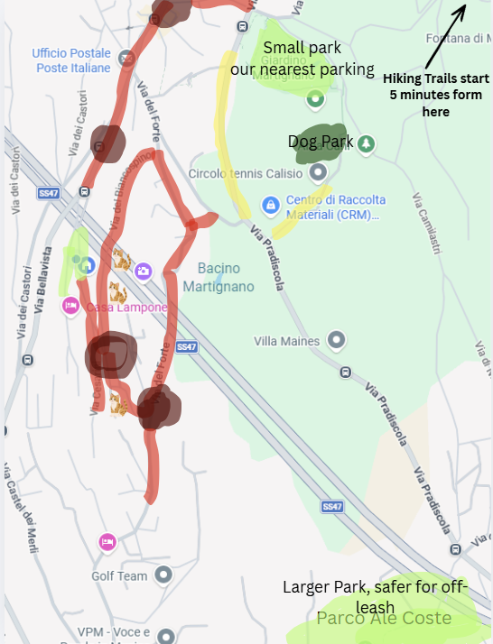

## Contents

- [Short summary](#at-a-glance)
  - [Behaviour by environment](#behaviour-by-environment)
- [Diary and progress reports](#diary-and-progress-reports)
  - [Baseline videos (November 2026)](#baseline-videos-november-2026)
  - [Progress log](#progress-log)
- [Objectives for Laila](#objectives-for-laila)
- [Questions for our first session](#questions-for-our-first-session)
- [Background and context](#background-and-context)
  - [Who we are](#who-we-are)
  - [Laila's story](#lailas-story)
  - [Health and daily basics](#health-and-daily-basics)
  - [Where we live and our constraints](#where-we-live-and-our-constraints)
  - [What Laila knows and loves](#what-laila-knows-and-loves)
  - [Main challenges](#main-challenges)
  - [How we handle dog encounters now](#how-we-handle-dog-encounters-now)
  - [What we have tried so far](#what-we-have-tried-so-far)
  - [Our difficulties](#our-difficulties)
  - [Axel, a bit about him as well](#axel-a-bit-about-him-as-well)

---

## At a glance

- **Laila:** female Brittany Spaniel (or very close), about 3½ years old, spayed. With us since November, 2026. She was rescued from a hunter, probably kept for breeding, together with her five 2-month-old puppies.
- **At home and in quiet dog parks**: engaged, quick to learn, perfect recall, playful.
- **As soon as we step outside** she goes into hyper-arousal: panting, high heart rate, scanning, pulling. Engagement and play mostly disappear.
- **Main issues:** on-leash reactivity to dogs, where she screams and lunges but has never bitten or made contact; prey triggers (cats make her tremble); fixation on places where she once saw something; anxiety in narrow streets, forests and low light; switching between anxious and predatory states.
- **Little generalisation.** A great day surrounded by dogs doesn't carry over to a different place or location.
- **Some progress:** she used to pant from the building hallway; now it starts only in the stressful areas. She is calmer on a ~200 m stretch from home. If space allows, she  chooses distance from dogs in wide open spaces.
- **Constraints:** we live on a hill with narrow streets and no easy escape routes. The car is a 15-minute walk away. 
- **What we need:** guidance and a semi-structured plan that we will stick to. I feel overwhelmed with all the information I tried to collect over the past year.

### Behaviour by environment

| Setting | Engagement | Recall | Play / food | Stress |
|---|---|---|---|---|
| **Home** | Excellent | Perfect | Plays, works for food or toys | Low |
| **Enclosed dog park** | Very good, like at home | Very good | Plays, works, interacts well with dogs | Low (sniffs for 4–5 minutes, then settles) |
| **Open park, on lead** | Fair | Fairly good in wide open space | Won't play or fetch | Medium |
| **Nature / trails** | Very low | Close to none | Won't play or fetch, sometimes refuses food | High: predatory or anxious, worse on narrow trails and in forest |
| **Urban / our streets** | Low, takes a lot of effort | Poor | Some obedience if stress is low | High, hard to bring back once over threshold |

---

## Diary and progress reports

### Baseline videos (November 2026)

These four videos show where we are starting from. I will add time stampts either here on youtube to make it a bit easier to browse.

#### 1. At home



#### 2. Parks



#### 3. Urban



#### 4. Nature



### Progress log

*We can add an entry after each session if useful.*

| Date | What we practised | What changed | Video |
|---|---|---|---|

<!-- Template for new entries (add below the header row):
| DD Mon YYYY | ... | ... | [link](https://youtu.be/...) |
-->

---

## Objectives for Laila

*Our wishes. We'd love your view on which are realistic and in what order.*

### Short term

- Extend the quality and distance of the walks starting from our home
- Learn how to work arroud her prey drive and reactivity
- Better engagement in Parks, and close to home
- Learn what to do to get her more engaged with us during hikes
- Learn how to better structure a day and a week of training

### Medium term

- Walk to the nearest park on foot in a calmer state. 
- On-lead time in nature where Laila sniffs and explores rather than pulling straight up the trail
- Engagement, retrieves and scent games working outside the home and dog park.

### Dreaming of

- Relaxed adventures and hikes with all four of us, as we used to have with Axel.
- Walking both dogs together safely.
- A cooperative activity Laila (and Axel) truly enjoy, such as scent detection (truffle or mushroom search) or mantrailing.
- Letting her run free in nature, at least now and then.

---

## Questions for our first session

1. **Where to start:** what is the single most important thing to work on first?
2. **Keep, reduce or stop:** a previous trainer told us to remove hikes, mantrailing, tug and complex work. We worry this just adds frustration. Are on-lead mountain hikes and park trips helping or harming her right now?
3. **Neighbourhood and no-escape encounters:** should we keep working in the neighbourhood? When there's no way to create distance, is it OK to crouch and hold her, or carry her to avoid a full reaction?
4. **Management:** How to create motivation and engagement in high arrousal states? I've been trying to allocate a share of her food to be provided during walks, preferably for engagmeent moments initiated by her, such a looking a me, walking close to me. 
5. **Leash pulling:** Should we work on it or allow some pulling for now, and get back to it when she is doing better overall

---

## Background and context

*Reference material: the full detail behind the summary above.*

### Who we are

- **Humans:** Sergiu and Patricia, living in Trento, northern Italy.
- **Dogs:** Axel (mixed breed, 5, 9 kg) and Laila (Brittany Spaniel, 3½, 12kg). Both are rescues from southern Italy.
- **Lifestyle:** we spend a lot of time in nature and enjoy taking the dogs with us on holidays (sometimes sleeping in the car with them). We like to bring the dogs everywhere, as long as they feel comfortable.

**Typical week now:**

- At least 3 walks a day, usually one dog each or all four of us together. Patricia can't walk safely both dogs at once.
- 2 workdays a week the dogs are alone for 7–8 hours, with access to a ~50 m² terrace. On the other days one of us works from home.
- A mountain hike (on lead) almost every weekend, sometimes just me and the 2 dogs (not easy)
- I drive Laila parks about 3-4 times a week.

**Before Laila (Axel's week):** 4 walks a day, trail or neighbourhood runs twice a week, a long hike or trail run plus mantrailing at the weekend, and often an evening in the city with friends.

### Laila's story

- Rescued by an NGO in Puglia from a hunter who, we were told, kept her in a tiny box with no roof. She was rescued with her five puppies (2 months old). She was probably used for breeding and selling puppies to other hunters rather than for hunting.
- She spent about a week in a shelter before coming to us.
- On arrival she was thin, desperate for food, and her coat was in very poor condition. We had her spayed.
- Her tail was docked very short, which makes her body language hard to read.
- **Why we took her:** we hoped our experience with Axel would let us give her a good life.  In hindsight we were overconfident. We wanted to enrich Axel's life with a companion, and to keep an adult hunting dog out of a shelter. The plan was to foster her until she found the right home if things didn't work out with Axel.
- **Today:** she has settled well at home and gets on with Axel. The challenges all begin outside the door.

### Health and daily basics

- **Vet checks:** All good, she did a lot of blood work and is a healthy dog. Digestion is also good now, she struggled in the begining with the change of food.
- **Weight and diet:** 12kg, she eats kibble (rabbit), dog treats (boiled pork, or treats prepared by me), and chews (tripe, rabbit ears and others)
- **Medication or supplements:** **[none / list]**
- **With people:** Very friendly, growled in a low voice only once at a mushroom hunter in the forest (but he had a big stick and a basket and was dressing in hunter type of clothes)
- **Car travel:** Much calmer now, it the begining we could not keep the windows open without her going pretty crazy.

### Where we live and our constraints

<!-- MAP: drop map.png next to this file and uncomment the line below.
     Ideally mark: home, the ~200 m stretch we practise on, routes to the nearest park, parking. -->

- A quiet residential area on the hills outside Trento, but almost all streets are **narrow**.
- Getting to the nearest park on foot means one of two routes:
  - a narrow sidewalk next to car traffic, with no escape if a dog approaches; or
  - narrow side streets where meeting dogs and cats is very likely.
- Our parking is **15 minutes' walk** away, near one of the parks.I drive Laila to parks about 3 times a week, not daily. My partner cannot drive.
- Progress so far: Laila is a bit calmer on a stretch of **less than 200 m** from home.

### What Laila knows and loves

**Cues:** sit, down, stay, turn, touch, bed, come, find it, seek, focus. *Heel* and *behind* are work in progress.

**Activities she loves** (at home or in quiet dog parks):

- Scentwork: searching for food, objects or people
- Gundog games: dummy retrieves, including blind retrieves
- Chews and puzzle/enrichment games
- Ball retrieving (we limit it)
- Tug

At home she is super engaged and learns very fast, though she can get frustrated quickly. I tried teaching things with shaping, but with little success. In dog parks, unlike Axel who is very busy to smell all the messages, she sniffs for only 4–5 minutes and then relaxes or invites play.

### Main challenges

**Arousal when going out.** She used to start panting in the building hallway. We would stop at the door and again a few steps later. This has improved: panting now starts in the more stressful areas. Once she's over threshold it is very hard to get her back.

**On-leash reactivity to dogs.** With enough space she can stay calm, and in very open areas we've seen her choose to move away from dogs and pass them. Without distance she screams and lunges at full power. She has never bitten or made contact. Once she can sniff the other dog, or its "messages", she usually defuses completely. Off lead she is increasingly competent with dogs. None of this transfers to moving on lead.

**Prey.** Birds, cats and lizards used to trigger her prey drive strongly. She gave up on birds after many failed attempts, all summer she hunted lizards (with some success). Cats are a very strong triggers. She start yelling and trembling

**Fixation on places.** If something happened somewhere (a cat, a dog, a rat), she anticipates it for weeks even months after.

**Environmental sensitivity.** Movement, lights and sounds all grab her attention, and she stares. Everything is worse at night and in low light, but lately this has improved a lot.

**Leash pulling.** In the past year we've been told everything from "just use a longer leash" to "let her pull but don't speed up". What we do now (as we did with Axel): give her as much leash as possible, and when she pulls, stop until the tension releases. When she is fully aroused, she would pull to exhaustion.

**Nature.** She is either fully predatory or anxious. On some walks she didn't put her nose to the ground for over an hour, just stayed at the end of the leash heading straight up the trail. She is often more anxious on the way back (tail down, worried look). Narrow trails and forest are hardest; open spaces help a lot.

**Little generalisation.** Her emotional state can changes so quickly and positive experiences in one place do not generalise to other places much. For instance, she had several days in which she interacted with many dogs, and was relaxed and calm. 

**Frustration and impulse control** outside are very low.

### How we handle dog encounters now

1. **Enough distance:** as soon as she sees the dog, we mark and reward (or just give a treat, without a marker, as classical conditioning). She then usually starts looking at us, and we mark and reward the look. In these situations she defuses completely.
2. **Shorter distance:** we first create space, then do the same as above.
3. **No way to create distance:** the only things that prevent a reaction are crouching down beside her with a hand on her, or, on very narrow trails, picking her up. In our experience this is better than letting her react, because recovery takes a long time.

**With Axel:** if Axel reacts to a male dog (something we are trying to work on), Laila reacts too, but not the other way round. So we only walk them together when we are both there or in very open spaces. It's quite rare than Axel reacts. 

### What we have tried so far

**Our main approach** has been classical conditioning: when she sees a trigger, before an emotional response, we mark ("yes" or clicker) and reward, or just reward. I also tried to learn and use Grisha Stewart's Behavior Adjustment Training (BAT) aproach, and am reading a lot on engaging activities for hunting dogs such as gundog retrieves and scentwork.

**Trainers:**

- UK trained trainer (one in-person session). He introduced us to classical conditioning for reactivity (treat on sight, no marker), which we still use and which sometimes helps.
- **Two schools using the zooanthropological approach**: no classical conditioning, no obedience, no markers, a long leash, and letting the dog work things out on her own terms. We learned a lot about body language. However, we got little practical structure, and the trainers often contradicted each other. Their advice was to let her go through a full reaction and reward her when she looks back. After 4 months with no improvement, we stopped. We think it's too much to expect a dog in Laila's state to offer the right behaviours without first being taught what they are. This is a very popular approach in Italy, and often the only alternative to coercion based approaches.
- **A dominance/correction-based trainer.** We did a couple of obedience sessions with positive reinforcement but then we found out that the the approach was also based on a on leash corrections, which goes against our values, so we stopped.
- **Our most recent trainer** was more structured and useful. She recommended removing all arousing activities (mantrailing, tug, complex work, even limiting nature walks), keeping obedience very simple, and walking short out-and-back lines. For example: walk 10 m from the building and back, 3–4 times, until Laila engages in both directions (she's calmer on the way back). Then come back only 5 m and go forward another 10 m. It helps, at least in some situations.
- **Online:** Grisha Stewart's courses, and the Scurry dog club (gundog games and activities).

### Our difficulties

- It has been overwhelming. I was clearly overconfident in my knowledge. I never expected it could be this challenging. From the videos we got with her and from the information provided, we expected a mildly fearful dog, as Axel was at the start, so I was confindent we could help her. 
- Every trainer gave us different advice, and we found it hard to know what to follow. I feel that I could've done better by applying consistenly what I learned online (from your videos and other fantastic trainers). 
- We fear that we can't meet Laila's needs where we live. We are also afraid of losing our trusted dog sitters which struggle a lot to handle Laila.
- We are very committed to flllow a programme consistently. I enjoy learning about dog training, reading as much as possible. But nothing can replace the expertise and experience of a trainer, especially with challenging stories such as Laila's.

### Axel, a bit about him as well

*Not the focus right now, but relevant because the two dogs affect each other, and we'd love to work on him with you later.*

- Mixed breed (some hunting genes), 9 kg, about 5 years old. He was found abandoned in a village in South Italy with his siblings at about 2 months old and came to us at 4–5 months.
- As a puppy he was afraid of almost everything except us: noises, people, sounds, white scooters. The only thing that pulled him out of a fear attack was seeing another dog. After more than a year of counter-conditioning, desensitisation and confidence-building (mantrailing helped hugely with people), he is now more balanced and confident and copes even with big, noisy cities. But it's something we need to work on continously. He was the bravest of the litter, so probably besides trauma, also genetics plays a role
- He is not (yet) neutered (vets advised against it).
- **Challenges:**
  - From about 2–2½ years he started showing aggression towards some male dogs, mostly in our neighbourhood and only at close range. It's manageable, but we'd like to give him more freedom.
  - He becomes territorial quickly: 5 minutes in a new garden and he's a guard dog.
  - He may bark at children and at some categories of people, and he has learned that barking makes people go away.
  - His recall isn't always reliable, so we let him off lead less.
- **Axel and Laila:**
  - Axel struggled a lot when she arrived. She was very jealous, pushing him away with her body or jumping on him when he got attention, and he avoided contact with her. It's much better now.
  - We reward them together, including for staying calm while the other works.
  - They play at home, and play is initiated by both. 
  - Sometimes she mounts his bed when they're alone, and he tries to mount her, but rarely.
  - He is obsessed with other dogs' scent marks and takes a long time to "read the messages" in dog parks before engaging with me, the opposite of Laila. It's easier to work with him in other areas, the opposite of Laila again.

---

